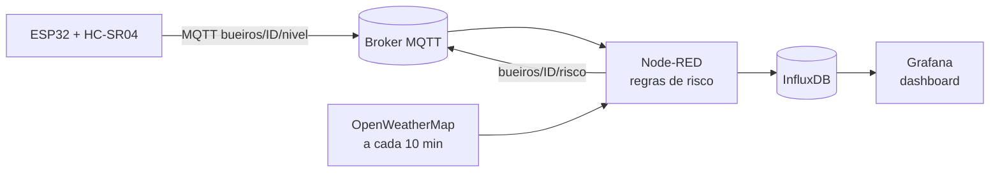
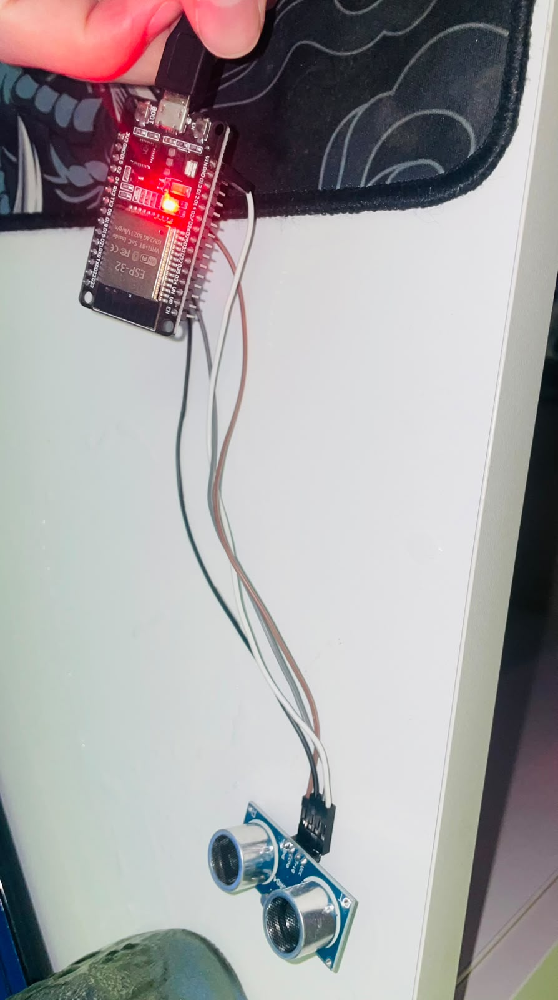
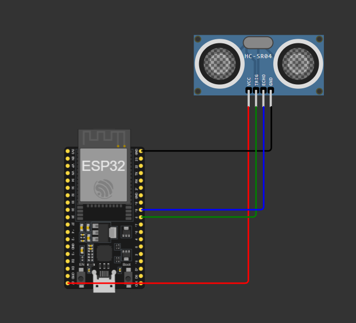
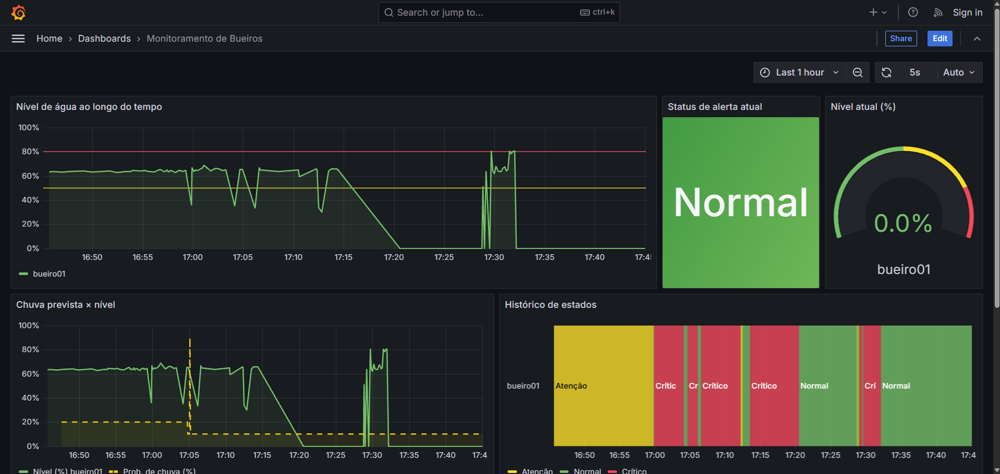
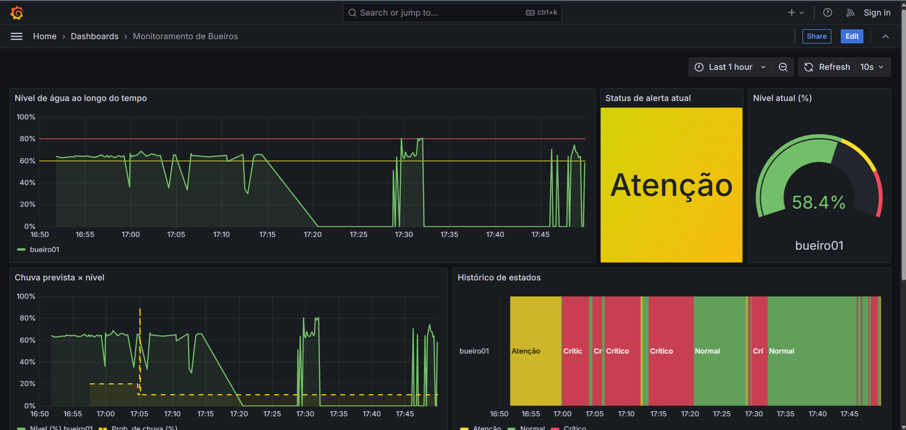
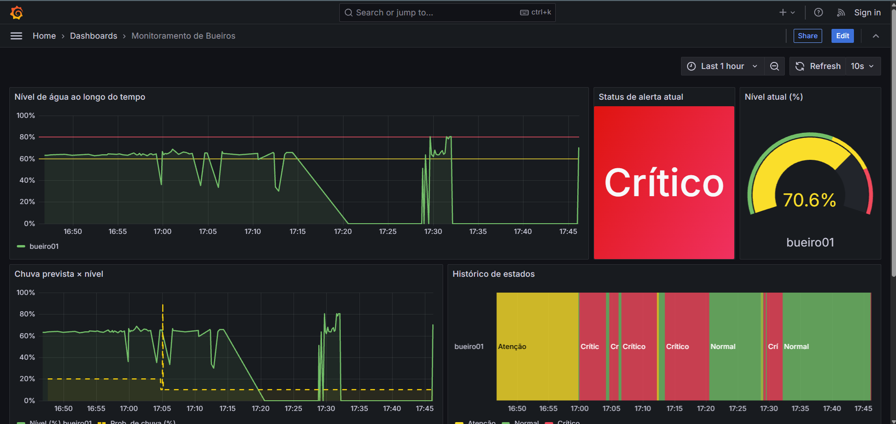

# Monitoramento Inteligente de Bueiros via IoT

Sistema que mede o nível de água de um bueiro com um **ESP32 + sensor ultrassônico HC-SR04**, envia os dados por **MQTT**, aplica regras de risco (incluindo **previsão de chuva do OpenWeatherMap**) no **Node-RED**, guarda o histórico no **InfluxDB** e mostra tudo em um dashboard **Grafana**.

Projeto acadêmico — Universidade Presbiteriana Mackenzie.



> **Quer só ver funcionando, sem o ESP32?** Siga os passos 1 a 5. O ESP32 (passo 6) é opcional: um simulador publica as leituras no lugar dele.

---

## Como fica funcionando

Protótipo montado (ESP32 + HC-SR04) e diagrama de ligação:

<p align="center"> &nbsp; </p>

Dashboard do Grafana nos três estados de risco (**normal**, **atenção** e **crítico**), obtidos aproximando um objeto do sensor:





## Vídeo de demonstração

> Link do vídeo no YouTube: https://youtu.be/jjVYw8rkyIc

## Topologia em nuvem (atende ao enunciado)

Broker MQTT (HiveMQ), Node-RED (PC), InfluxDB Cloud e Grafana Cloud em servidores distintos, com FQDN e IP de cada um. Veja [docs/modo-nuvem.md](docs/modo-nuvem.md). A pilha local abaixo continua válida para rodar tudo offline.

## Sumário
1. [O que você precisa](#1-o-que-você-precisa)
2. [Baixar o projeto](#2-baixar-o-projeto)
3. [Subir toda a pilha (escolha A ou B)](#3-subir-toda-a-pilha-escolha-a-ou-b)
4. [Abrir as telas](#4-abrir-as-telas)
5. [Testar sem hardware (simulador)](#5-testar-sem-hardware-simulador)
6. [Montar e gravar o ESP32](#6-montar-e-gravar-o-esp32-opcional)
7. [Ligar a previsão de chuva (OpenWeatherMap)](#7-ligar-a-previsão-de-chuva-openweathermap)
8. [Como saber se está tudo certo](#8-como-saber-se-está-tudo-certo)
9. [Regras de negócio](#regras-de-negócio)
10. [Estrutura do repositório](#estrutura-do-repositório)
11. [Problemas comuns](#problemas-comuns)

---

## 1. O que você precisa

| Item | Para quê | Obrigatório? |
|---|---|---|
| Computador com **Windows 10/11**, Linux ou macOS | roda a pilha de software | sim |
| **Git** — https://git-scm.com/downloads | baixar o projeto | sim |
| **Docker Desktop** — https://www.docker.com/products/docker-desktop | **Opção A** (a mais simples: 1 comando) | uma das duas |
| **Node.js 18+** — https://nodejs.org | **Opção B** (Windows sem Docker) | uma das duas |
| Conta grátis no **OpenWeatherMap** — https://openweathermap.org/api | previsão de chuva real | opcional (sem ela a previsão é simulada) |
| **ESP32** + **HC-SR04** + jumpers + cabo USB | medir o nível de verdade | opcional |
| **Arduino IDE 1.8.19 ou 2.x** — https://www.arduino.cc/en/software | gravar o ESP32 | só com o ESP32 |

## 2. Baixar o projeto

Abra o terminal (PowerShell no Windows) e rode:

```powershell
git clone https://github.com/EduardoBighetti/monitoramento-bueiros-iot.git
cd monitoramento-bueiros-iot
```

## 3. Subir toda a pilha (escolha A ou B)

### Opção A — Docker (recomendada, 1 comando)

1. Abra o **Docker Desktop** e espere aparecer "Engine running".
2. Crie o arquivo de configuração a partir do modelo:
   ```powershell
   Copy-Item .env.example .env
   ```
   (Linux/macOS: `cp .env.example .env`). Pode deixar os valores como estão.
3. Suba tudo:
   ```powershell
   docker compose up -d --build
   ```
   Na primeira vez baixa as imagens (alguns minutos). Para conferir: `docker compose ps` — os 5 serviços devem estar `running`.
4. Para desligar: `docker compose down` (os dados ficam guardados; `docker compose down -v` apaga tudo).

### Opção B — Windows sem Docker

Precisa do **Node.js 18+** instalado. No PowerShell, dentro da pasta do projeto:

```powershell
cd windows-sem-docker
powershell -ExecutionPolicy Bypass -File .\INSTALAR.ps1     # uma única vez (baixa ~250 MB)
powershell -ExecutionPolicy Bypass -File .\INICIAR.ps1      # liga tudo (use sempre que ligar o PC)
```

O `INSTALAR.ps1` baixa e configura sozinho: broker MQTT (Aedes), Node-RED, InfluxDB 2.7 e Grafana 11.3. Detalhes e instalação manual em [docs/windows-sem-docker.md](docs/windows-sem-docker.md).

## 4. Abrir as telas

| O que é | Endereço | Login |
|---|---|---|
| **Grafana** — dashboard final | http://localhost:3000/d/bueiros-monitoramento | não precisa |
| **Monitor MQTT** — mensagens chegando no broker | http://localhost:8085 | não precisa |
| **Node-RED** — fluxo e regras | http://localhost:1880 | não precisa |
| **InfluxDB** — banco de dados | http://localhost:8086 | usuário `bueiros` e a senha do `.env` (Opção A: `bueiros-senha-123`) |

## 5. Testar sem hardware (simulador)

Com a pilha no ar e o **Grafana** aberto, rode o simulador. Ele faz o papel do ESP32 e simula a água subindo e descendo (bueiro de 50 cm):

**Opção A (Docker)**
```powershell
powershell -ExecutionPolicy Bypass -File .\scripts\simular.ps1
```
(Linux/macOS: `sh scripts/simular.sh`)

**Opção B (Windows sem Docker)**
```powershell
cd windows-sem-docker\broker
node simular.js
```

Você verá `publicado: {...}` a cada 5 s. Em até 10 s o Grafana mostra o bueiro `simulado01` passando por **Normal → Atenção → Crítico → Atenção → Normal**.

Para escolher as distâncias: `.\scripts\simular.ps1 -Distancias 45,25,8` (Docker) ou `node simular.js 127.0.0.1 45 25 8` (Opção B).

| Distância do sensor à água | Nível | Estado |
|---|---|---|
| 45 cm | 10 % | normal |
| 25 cm | 50 % | atenção |
| 8 cm | 84 % | crítico |

## 6. Montar e gravar o ESP32 (opcional)

Guia completo com tabela de ligação, bibliotecas e solução de erros: [docs/esp32.md](docs/esp32.md). Resumo:

1. **Ligações:** HC-SR04 `VCC` → 5V (VIN) · `GND` → GND · `TRIG` → GPIO 5 · `ECHO` → GPIO 18.
2. Abra `firmware/bueiro_iot/bueiro_iot.ino` no Arduino IDE.
3. Edite `firmware/bueiro_iot/config.h`: nome e senha do **Wi-Fi** e `MQTT_HOST` = **IP do computador** que roda a pilha (veja com `ipconfig`). O ESP32 e o computador precisam estar **na mesma rede**.
4. Instale a placa **esp32 (Espressif)** e a biblioteca **PubSubClient**, escolha *ESP32 Dev Module* e a porta COM, e clique em **Upload** (se travar em "Connecting...", segure o botão **BOOT**).
5. Abra o **Serial Monitor** em **115200** baud: deve aparecer `Wi-Fi OK`, `Conectando ao broker ... OK` e uma linha `[bueiros/bueiro01/nivel] {...}` a cada 10 s.
6. Libere a porta **1883** no firewall do Windows (PowerShell **como administrador**):
   ```powershell
   New-NetFirewallRule -DisplayName "MQTT bueiros 1883" -Direction Inbound -Protocol TCP -LocalPort 1883 -Action Allow -Profile Private
   ```

## 7. Ligar a previsão de chuva (OpenWeatherMap)

Sem chave, o fluxo usa uma previsão **simulada** (20 % de chuva) para tudo funcionar. Para a previsão real:

1. Crie uma conta e copie a **API key** em https://home.openweathermap.org/api_keys (a chave leva de alguns minutos a 2 horas para ativar).
2. **Opção A (Docker):** abra o arquivo `.env`, preencha `OPENWEATHER_KEY=sua_chave` e rode `docker compose up -d` de novo.
3. **Opção B (Windows sem Docker):** rode
   ```powershell
   cd windows-sem-docker
   powershell -ExecutionPolicy Bypass -File .\DEFINIR-CHAVE.ps1 -Chave "sua_chave"
   ```
   (ou passe `-OpenWeatherKey "sua_chave"` já no `INSTALAR.ps1`). A chave fica em `windows-sem-docker/runtime/openweather.key`, fora do GitHub.
4. No Node-RED, clique no quadrado do nó **A cada 10 min** para consultar agora. O nó *Extrair pop e chuva* passa a mostrar `OpenWeatherMap: X% / Y mm`.

A localização usada é **Mackenzie, São Paulo** (variáveis `BUEIRO_LAT`, `BUEIRO_LON` e `BUEIRO_LOCAL`: no Node-RED, duplo clique na aba **Monitoramento de Bueiros** → ícone **Variáveis de Ambiente**). A altura do bueiro é `BUEIRO_ALTURA_CM` (padrão **100 cm**).

Para **demonstrar a regra da chuva** sem esperar o tempo mudar, use no Node-RED os botões **Simular chuva forte (90% / 5 mm)** e **Sem chuva (10% / 0 mm)** (clique no quadrado à esquerda do nó).

## 8. Como saber se está tudo certo

| Onde olhar | O que deve aparecer |
|---|---|
| **Monitor MQTT** (:8085) | "conectado ao broker" e mensagens `bueiros/.../nivel` chegando |
| **Node-RED** (:1880) | nós com "conectado" (verde) e o painel de depuração com *Ponto gravado* / *Risco publicado* |
| **InfluxDB** (:8086) → *Data Explorer* → bucket `bueiros` → `nivel_bueiro` → Submit | tabela com `distancia_cm`, `nivel_cm`, `nivel_pct`, `estado` |
| **Grafana** (:3000) | nível ao longo do tempo, status atual, gauge, chuva × nível, histórico de estados, eventos críticos e tabela de últimas leituras |

## Regras de negócio

- **Nível** = altura do bueiro − distância medida; **%** = nível ÷ altura.
- **Estado:** `normal` (< 40 %) · `atenção` (40 % a < 80 %) · `crítico` (≥ 80 %).
- **Chuva:** probabilidade ≥ 70 % **ou** volume ≥ 2,5 mm → sobe **um nível** de risco.
- **Subida rápida:** ≥ 15 pontos percentuais em 5 min → sobe **um nível**.
- **Previsão antiga** (mais de 1 h) é ignorada. **Leitura inválida** (fora de 2–400 cm) é descartada; distância maior que a altura do bueiro vale nível 0 % (bueiro vazio). Evento **offline** do dispositivo é registrado.
- O risco calculado volta ao broker em `bueiros/{id}/risco` (retido).

Mais detalhes (tópicos, formato JSON, measurements do InfluxDB): [docs/regras-e-dados.md](docs/regras-e-dados.md).

Para repetir os casos de teste das regras (nível, chuva, subida rápida, leituras inválidas, offline e latência) com a pilha ligada: `cd windows-sem-docker/broker` e `node testar-regras.js 50` (50 = altura do bueiro em cm, a mesma do fluxo).

Documentação acadêmica completa do projeto (artigo): [docs/Artigo_Monitoramento_Bueiros_IoT.docx](docs/Artigo_Monitoramento_Bueiros_IoT.docx).

## Estrutura do repositório

```
monitoramento-bueiros-iot/
├── README.md                 <- este guia
├── docker-compose.yml        <- sobe tudo (Opção A)
├── .env.example              <- modelo de configuração (copie para .env)
├── docker/                   <- configuração dos containers (Mosquitto, Node-RED, Grafana)
├── firmware/bueiro_iot/      <- código do ESP32 (.ino + config.h)
├── node-red/flows.json       <- fluxo do Node-RED (importável)
├── grafana/                  <- dashboard do Grafana (JSON importável)
├── monitor/                  <- página "Monitor MQTT"
├── scripts/                  <- simulador do ESP32 (Docker)
├── windows-sem-docker/       <- INSTALAR.ps1 / INICIAR.ps1 / broker (Opção B)
└── docs/                     <- guias detalhados
```

## Problemas comuns

Lista completa em [docs/solucao-de-problemas.md](docs/solucao-de-problemas.md). Os mais comuns:

- **Grafana sem dados** → o simulador/ESP32 não está publicando, ou o intervalo no canto superior direito é curto demais (escolha *Last 1 hour*).
- **ESP32 não conecta no MQTT** → `MQTT_HOST` errado (use o IP atual do computador), firewall da porta 1883, ou computador e ESP32 em redes diferentes.
- **Sempre "normal" / 0 %** → a distância medida é maior que a altura do bueiro (`BUEIRO_ALTURA_CM`, padrão 50 cm); aproxime um objeto do sensor ou aumente a altura.
- **Chuva sempre 20 %** → falta a chave do OpenWeatherMap (passo 7).

## Licença e créditos

Projeto acadêmico. Componentes de terceiros: Mosquitto, Node-RED, InfluxDB, Grafana, Aedes e PubSubClient, cada um com sua licença.
